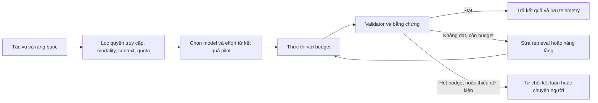

# Nghiên cứu LLM cho Task Routing & Pilot Test

Ngày đối chiếu: **15/10/2026**, múi giờ Asia/Saigon. Đơn vị giá: USD, chưa gồm thuế. Phạm vi: model sinh văn bản, reasoning và coding; không gộp model ảnh, giọng nói, embedding hoặc model an ninh truy cập hạn chế vào cùng bảng.

**Kết luận kiến trúc:** dùng benchmark công khai để lập danh sách ứng viên, sau đó chọn model theo **chi phí trên tác vụ đạt yêu cầu**, với ràng buộc chất lượng và latency. Không có căn cứ để chọn một model duy nhất tốt nhất cho mọi tác vụ. Đây là nghiên cứu nguồn công khai, **chưa phải kết quả gọi API thực nghiệm**.

Danh mục hiện tại đã vượt các ví dụ GPT-5, Claude 4 và Gemini 2.5. Báo cáo tách model hiện hành ưu tiên thử nghiệm khỏi baseline lịch sử. Không coi mọi snapshot cũ còn tài liệu là model còn được triển khai cho mọi tài khoản. Các ô `NR` nghĩa là chưa xác minh được số tương ứng trong nguồn đã đọc, không phải điểm 0 hay khẳng định hãng chưa từng công bố.

## Phần 1 — Danh mục model: Web và API

### 1.1. Free-tier và Web consumer

| Provider | Web miễn phí | Web trả phí cá nhân | API miễn phí / giới hạn |
|---|---|---|---|
| OpenAI | ChatGPT Free; tài liệu hiện tại ghi GPT-5.6 Luna cho Chat, Instant/Think; rollout có thể khác giữa tài khoản | Go $8/tháng; Plus $20; Pro $100/$200/$500. Trong Chat, GPT-6 Sol phục vụ các mức Instant–Extra High tùy gói; Pro effort dùng Astra. GPT-6.1 Sol là lựa chọn Work/Codex, không đồng nhất với model Chat | Trang Astra và Luna ghi Free: không hỗ trợ. Không giả định có quota API miễn phí thường trực từ gói ChatGPT |
| Anthropic | Claude Free có Sonnet và Haiku; quota theo mức sử dụng | Pro $20/tháng hoặc $200/năm; Max từ $100/tháng, hai mức 5x/20x. Opus thuộc gói trả phí; Fable dùng allowance/credits tùy gói | Không xác nhận được free-tier API thường trực. Max/Team có API credits kèm gói theo điều kiện, không phải API miễn phí cho mọi người |
| Google | Gemini không có AI plan: context Web 32K, quota tiêu chuẩn | AI Plus: Web 128K; AI Pro/Ultra: Web 1M. Có các mức Ultra 5x/20x. Giá địa phương không xuất hiện trong nội dung trang đã truy xuất, nên để chưa xác minh | Gemini 3.8 Flash, 3.6 Flash, 3.5/3.1 Flash-Lite có free-tier; Argon và 3.1 Pro Preview không có free-tier API |

Nguồn: [ChatGPT pricing](https://learn.chatgpt.com/docs/pricing), [model trong ChatGPT](https://help.openai.com/en/articles/20001354-gpt-6-and-other-models-in-chatgpt), [Claude pricing](https://claude.com/pricing), [Claude API credits](https://platform.claude.com/docs/en/about-claude/api-credits-for-subscribers), [Gemini Web limits](https://support.google.com/gemini/answer/16275805?hl=en), [Google AI plans](https://one.google.com/about/google-ai-plans/), [Gemini API pricing](https://ai.google.dev/gemini-api/docs/pricing).

**Không chuyển context API sang Web một cách mặc định.** Context API là khả năng endpoint; Web còn có system prompt, công cụ, lịch sử và giới hạn sản phẩm. Ví dụ Gemini Web Free 32K không có nghĩa Gemini Flash API chỉ nhận được 32K.

**Rate limits:** Google yêu cầu xem RPM, TPM và RPD thực tế trong AI Studio; quota áp dụng theo project, không theo API key. Trang hiện hành không cho một bộ RPM/TPM/RPD miễn phí cố định đáng tin cậy cho mọi tài khoản. Vì vậy database để các trường này `null`, lấy snapshot từ project trước pilot. Với OpenAI, ví dụ paid Build của Astra là 5.000 RPM/1M TPM; Luna là 5.000 RPM/2M TPM. Đây không phải free quota. Nguồn: [Google rate limits](https://ai.google.dev/gemini-api/docs/rate-limits), [Astra](https://developers.openai.com/api/docs/models/gpt-6-astra), [Luna](https://developers.openai.com/api/docs/models/gpt-6-luna).

### 1.2. API: danh mục hiện hành ưu tiên pilot

Giá dưới đây là **Standard, input chưa cache / output trên 1 triệu token**. Giá output reasoning không nên chỉ nhân với văn bản người dùng nhìn thấy. `1M` của Claude được giữ nguyên cách công bố; Google công bố 1.048.576 và OpenAI 1.050.000 token.

| Provider | Model Identifier | Context | Cơ chế | Input / Output |
|---|---|---:|---|---:|
| OpenAI | `gpt-6-astra` | 1.050.000 | Reasoning, low–max | $10 / $50 |
| OpenAI | `gpt-6.1-sol` | 1.050.000 | Reasoning, low–max | $2 / $10 |
| OpenAI | `gpt-6-luna` | 1.050.000 | General + reasoning tùy mức; có none | $0,10 / $0,50 |
| Anthropic | `claude-fable-5-1` | 1M | Adaptive thinking luôn bật | $10 / $50 |
| Anthropic | `claude-opus-5-5` | 1M | Adaptive thinking luôn bật | $4 / $20 |
| Anthropic | `claude-sonnet-5-5` | 1M | Adaptive thinking | $2 / $10 |
| Anthropic | `claude-haiku-5-5` | 1M | Adaptive thinking | $0,10 / $0,50 ở prompt ≤100K |
| Google | `gemini-4-argon` | 1.048.576, tổng input + output | Reasoning | $2 / $10, giá khuyến mại |
| Google | `gemini-3.8-flash` | Input 1.048.576 | Thinking low/medium/high | $0,75 / $3,75, giá khuyến mại |
| Google | `gemini-3.5-flash-lite` | Input 1.048.576 | General, hỗ trợ thinking | $0,30 / $2,50 |
| Google | `gemini-3.1-pro-preview` | Input 1.048.576 | Thinking, preview | $2 / $12 ở prompt ≤200K |

Nguồn thông số: [OpenAI catalog](https://developers.openai.com/api/docs/models), [Claude catalog](https://platform.claude.com/docs/en/models/overview), [Argon](https://ai.google.dev/gemini-api/docs/models/gemini-4-argon), [Flash 3.8](https://ai.google.dev/gemini-api/docs/models/gemini-3.8-flash), [Flash-Lite 3.5](https://ai.google.dev/gemini-api/docs/models/gemini-3.5-flash-lite), [Pro 3.1 Preview](https://ai.google.dev/gemini-api/docs/models/gemini-3.1-pro-preview). Giá: [OpenAI](https://developers.openai.com/api/docs/pricing), [Claude](https://claude.com/pricing), [Google](https://ai.google.dev/gemini-api/docs/pricing).

Điều kiện phải đưa vào cost engine:

- OpenAI niêm yết long-context: Astra $20/$75, Sol $4/$15, Luna $0,20/$0,75. Ngưỡng áp dụng chưa xác minh từ trang giá đã đọc; phải bổ sung trước khi tính hóa đơn prompt dài.
- Haiku 5.5 với prompt >100K: $0,50/$2,50. Không áp giá $0,10/$0,50 cho toàn bộ context 1M.
- Gemini 3.1 Pro >200K: $4/$18. Argon chuyển sang $4/$20 từ 01/12/2026; Flash 3.8 sang $1,50/$7,50 từ 01/01/2027.
- Cache read, cache write, storage, tool calls, Batch/Flex/Fast là SKU riêng. Không dùng giá Batch để báo giá workload tương tác Standard. Nguồn: các trang giá ở trên.

OpenAI và Claude hiện hành trong bảng cho output tối đa 128K. Flash 3.8, Flash-Lite 3.5 và Pro 3.1: 65.536. Argon mặc định đồng bộ 65.536, long decode có thể cao hơn nhưng vẫn chịu tổng context chung. Nguồn: các trang model tương ứng ở trên.

### 1.3. Baseline cũ để đối chiếu, không gọi là flagship mới nhất

| API identifier | Context | Cơ chế | Input / Output $/1M | Mục đích giữ lại |
|---|---:|---|---:|---|
| `gpt-5-mini` | 400K | Reasoning | 0,25 / 2 | Baseline mini |
| `gpt-5-nano` | 400K | Reasoning | 0,05 / 0,40 | Baseline cực rẻ |
| `o3` | 200K | Reasoning | Cần kiểm tra giá tại lần chạy | Baseline o-series |
| `gpt-4.1-mini` | 1.047.576 | General, không có reasoning effort như GPT-5 | 0,40 / 1,60 | Baseline không thinking |

Nguồn: [GPT-5 mini](https://developers.openai.com/api/docs/models/gpt-5-mini), [GPT-5 nano](https://developers.openai.com/api/docs/models/gpt-5-nano), [o3](https://developers.openai.com/api/docs/models/o3), [GPT-4.1 mini](https://developers.openai.com/api/docs/models/gpt-4.1-mini).

Các phiên bản Gemini Flash trung gian, GPT-5.x và Claude 4.x/5.0 cần giữ trong registry nếu hệ thống đang dùng chúng; không nhất thiết đưa tất cả vào vòng pilot đầu. `Ultra` là tên gói consumer Google trong ngữ cảnh hiện tại, không phải model ID API để routing. Tương tự, không lưu `Claude Pro` hay `ChatGPT Plus` vào trường model ID.

## Phần 2 — Ma trận benchmark chính thức và khoảng trống dữ liệu

### 2.1. Quy tắc đọc số liệu

Một observation phải có: model/version, benchmark/version/split, metric, effort, tool access, harness, số lần thử, nguồn và ngày truy xuất. Thiếu metadata thì giảm mức độ so sánh, không tự lấp bằng cấu hình mặc định API.

`pass@1` được ước lượng bằng nhiều lần chạy vẫn khác với cho một tác vụ nhiều cơ hội rồi chọn đáp án tốt nhất. SWE-bench Verified khác SWE-bench Pro; LiveCodeBench accuracy khác LiveCodeBench Pro Elo; MMLU khác Global MMLU Lite; MRCR/GraphWalks khác NIAH/RULER.

### 2.2. Các số có thể xác minh cho thế hệ hiện hành

Đơn vị % trừ chỗ ghi Elo. Ô NR không được nội suy từ thế hệ trước.

| Model | GPQA Diamond | SWE Verified / Pro | Coding bổ sung | Nguồn / điều kiện |
|---|---:|---|---|---|
| GPT-6 Astra | 96,0 | NR / NR | Terminal-Bench 4.0: 57,9 | OpenAI công bố; cấu hình benchmark riêng |
| GPT-6.1 Sol | NR | NR / NR | OpenAI nói đạt mức Astra ở DeepSWE v1.1; không nhập một điểm suy ra vào DB | Bài ra mắt Sol |
| GPT-6 Luna | NR | NR / NR | NR trong nguồn tự công bố đã xác minh | Đo pilot |
| Claude Fable 5.1 | NR | NR / NR | Terminal-Bench 4.0: 55,8 | Bảng Anthropic ở bài Opus 5.5 |
| Claude Opus 5.5 | NR | NR / NR | Terminal-Bench 4.0: 66,4 | Anthropic |
| Claude Sonnet 5.5 | NR | NR / NR | Terminal-Bench 4.0: 70,6 | Anthropic; không mặc định cùng effort với Opus |
| Claude Haiku 5.5 | NR | NR / NR | Terminal-Bench 4.0: 39,2 | Anthropic |
| Gemini 4 Argon | NR | NR / NR | DeepSWE v1.1: 77,9; Terminal-Bench 4.0: 57,4 | Google; highest thinking trừ ngoại lệ |
| Gemini 3.8 Flash | NR trong model card đã đọc | NR / NR | DeepSWE v1.1: 73,7; Terminal-Bench 4.0: 19,1 | Google |
| Gemini 3.5 Flash-Lite | NR | NR / 54,2 | Terminal-Bench 2.1: 54,0 | Google; Terminus-2 cho Terminal-Bench |
| Gemini 3.1 Pro Thinking High | 94,3 | 80,6 / 54,2 | LiveCodeBench Pro: 2887 Elo | Google; GPQA không tools, SWE một lần thử |

Nguồn: [Astra](https://openai.com/index/gpt-6-astra/), [Sol](https://openai.com/index/introducing-gpt-6-1-sol/), [Opus](https://www.anthropic.com/claude-opus-5-5), [Sonnet](https://www.anthropic.com/claude-sonnet-5-5), [Haiku](https://www.anthropic.com/claude-haiku-5-5), [Argon card](https://deepmind.google/models/model-cards/gemini-4-argon/), [Flash card](https://deepmind.google/models/model-cards/gemini-3-8-flash/), [Flash-Lite card](https://deepmind.google/models/model-cards/gemini-3-5-flash-lite/), [Pro 3.1 card](https://deepmind.google/models/model-cards/gemini-3-1-pro/).

**Không xếp hạng tổng từ bảng này.** Ví dụ 70,6 của Sonnet không chứng minh Sonnet tốt hơn Opus ở mọi agent; effort và ngân sách tác vụ có thể khác. Một số system card Claude mới trả lỗi khi truy xuất; báo cáo dùng bảng hãng công bố và không tự bổ sung số từ trang tổng hợp.

### 2.3. Baseline lịch sử trên bộ test người dùng yêu cầu

| Model / cấu hình | GPQA Diamond | AIME 2025, không tools | SWE-bench Verified | LiveCodeBench |
|---|---:|---:|---:|---:|
| GPT-5 high | 85,7 | 94,6 | 74,9 | NR |
| GPT-5 mini high | 82,3 | 91,1 | 71,0 | NR |
| GPT-5 nano high | 71,2 | 85,2 | 54,7 | NR |
| o3 high | 83,3 | 88,9 | 69,1 | NR |
| o4-mini high | 81,4 | 92,7 | 68,1 | NR |
| Claude Opus 4 | NR tại nguồn Anthropic đã đọc | NR | 72,5 | NR |
| Claude Sonnet 4 | NR tại nguồn Anthropic đã đọc | NR | 72,7 | NR |
| Claude Haiku 4.5 | NR | NR | 73,3 | NR |
| Gemini 2.5 Pro | 86,4 | 88,0 | 59,6 một lần; 67,2 nhiều lần | 74,2 |
| Gemini 2.5 Flash | 82,8 | 72,0 | 48,9 một lần; 60,3 nhiều lần | 59,3 |

Nguồn: [GPT-5 developer benchmarks](https://openai.com/index/introducing-gpt-5-for-developers/), [Claude 4](https://www.anthropic.com/news/claude-4), [Haiku 4.5 và methodology](https://www.anthropic.com/news/claude-haiku-4-5), [Gemini 2.5 technical report, bảng 3](https://storage.googleapis.com/deepmind-media/gemini/gemini_v2_5_report.pdf).

OpenAI dùng 477/500 SWE Verified tasks chạy được trên hạ tầng của họ. Haiku 4.5 dùng đầy đủ 500, trung bình 50 trials và thinking budget 128K. Gemini LiveCodeBench trong báo cáo dùng khoảng bài 01/01–01/05/2025. Các khác biệt này phải nằm trong metadata, không bỏ khi đưa số vào dashboard.

**MMLU và các ô thiếu:** GPT-4.1 đạt MMLU 90,2%; mini 87,5%; nano 80,1% theo [bảng OpenAI](https://openai.com/index/gpt-4-1/). Chưa xác minh được ma trận MMLU-Pro, HumanEval, MATH-500 và RULER đầy đủ cho shortlist hiện hành. Giữ `null` từng metric. Không dùng AIME thay MATH-500 hay LiveCodeBench Pro Elo thay HumanEval pass@1.

### 2.4. Long-context: đánh giá khả năng sử dụng, không chỉ sức chứa

| Benchmark / cấu hình | Model | Điểm |
|---|---|---:|
| GraphWalks BFS F1, ≤128K / 256K–1M | Gemini 4 Argon | 99,7 / 84,2 |
| Cùng bảng thử GraphWalks của Google | GPT-6 Astra | 98,7 / 71,8 |
| Cùng bảng thử GraphWalks của Google | Claude Fable 5.1 | 91,4 / 65,0 |
| Cùng bảng thử GraphWalks của Google | Claude Opus 5.5 | 90,6 / 66,8 |
| MRCR v2, 8-needle, ≤128K average / 1M pointwise | Gemini 3.5 Flash-Lite | 72,2 / 21,3 |
| NIAH chuẩn hóa cùng độ dài/vị trí | Shortlist hiện hành | NR |
| RULER cùng task mix và độ dài | Shortlist hiện hành | NR |

Nguồn: [Argon model card](https://deepmind.google/models/model-cards/gemini-4-argon/), [methodology](https://deepmind.google/models/evals-methodology/gemini-4-argon), [Flash-Lite card](https://deepmind.google/models/model-cards/gemini-3-5-flash-lite/). GraphWalks ở đây là Google chạy cho cả bốn model, không phải bốn hãng tự đo. MRCR hai cột là hai cách tổng hợp khác nhau; không diễn giải chênh lệch như suy giảm trên cùng một tập mẫu.

Hệ quả thiết kế: nạp được 1M token không đảm bảo tìm đủ bằng chứng. Pilot cần câu hỏi một nguồn, nhiều nguồn, thông tin mâu thuẫn, không có đáp án và bằng chứng ở giữa tài liệu. Với RAG, đo retrieval recall riêng để phân biệt retriever bỏ sót với generator suy luận sai.

### 2.5. Latency, TTFT, tốc độ và giá

Không có phép đo API trực tiếp trong nghiên cứu này. Các nguồn đã đọc không cung cấp bộ TTFT/tokens-per-second đồng điều kiện cho toàn shortlist, nên **không gán số ước lượng giả cho từng model**.

| Nhóm ứng viên | TTFT p50/p95 | Output token/s | Điều có thể kết luận trước pilot |
|---|---|---|---|
| Luna / Haiku / Flash-Lite | Chưa đo | Chưa đo | Ứng viên kiểm tra cho workload ngắn, throughput cao |
| Sol / Sonnet / Flash | Chưa đo | Chưa đo | Kiểm tra trade-off effort–latency–accuracy |
| Astra / Fable / Opus / Argon / Pro | Chưa đo | Chưa đo | Phải đo overhead thinking và đuôi latency |

Anthropic chỉ ra thứ tự tương đối Fable chậm hơn, Opus trung bình, Sonnet nhanh, Haiku nhanh nhất trong catalog; đó không phải số tuyệt đối hoặc so sánh chéo hãng. [Claude catalog](https://platform.claude.com/docs/en/models/overview).

Cách đo: `TTFT_answer = thời điểm token trả lời đầu tiên − thời điểm gửi request`; log thêm first event và first tool call. `output_speed = (visible_output_tokens − 1)/(last_token_time − first_token_time)`. Với output <2 token để null. Tách request có tool, reasoning, cache hit/miss, input length và concurrency. Giữ p50/p95/p99 của end-to-end latency; không chỉ tốc độ decode.

Ước lượng ngân sách minh họa, cùng **10.000 input + 2.000 billable output**, không cache/tools/retry, short-context:

| Model | USD / lần gọi |
|---|---:|
| GPT-6 Luna hoặc Haiku 5.5 ≤100K | 0,002 |
| Gemini 3.5 Flash-Lite | 0,008 |
| Gemini 3.8 Flash, giá hiện tại | 0,015 |
| GPT-6.1 Sol hoặc Sonnet 5.5 | 0,040 |
| Gemini 4 Argon, giá hiện tại | 0,040 |
| Gemini 3.1 Pro ≤200K | 0,044 |
| Opus 5.5 | 0,080 |
| Astra hoặc Fable 5.1 | 0,200 |

Đây là phép tính từ giá phần 1, không phải chi phí thực nghiệm. Cùng văn bản có thể ra số token khác nhau ở mỗi tokenizer. Hai nghìn token nhìn thấy cộng nhiều token reasoning sẽ tốn hơn ví dụ này.

## Phần 3 — Điểm mạnh, điểm yếu và performance

Các khuyến nghị sau là suy luận kiến trúc từ tài liệu, cần kiểm nghiệm trên dữ liệu nội bộ.

### 3.1. Flagship và nhóm cân bằng

| Model | Lợi thế có cơ sở | Điểm cần kiểm tra / giới hạn |
|---|---|---|
| GPT-6 Astra | Ứng viên cho reasoning khó, scientific/coding; GPQA và agent evals mạnh | Giá token cao; mức max không phải mặc định kinh tế. Context dài vẫn cần retrieval và kiểm chứng |
| GPT-6.1 Sol | Ứng viên mặc định cho coding/knowledge work; giá Standard bằng 1/5 Astra | Tuyên bố gần Astra không chứng minh ngang nhau trên dữ liệu của doanh nghiệp; giữ Astra làm tầng nâng cấp |
| Claude Opus 5.5 | Agent coding dài, sửa hệ thống nhiều file; Anthropic công bố lợi thế cost/task ở FrontierCode | Tác vụ mơ hồ phải có acceptance tests. Thinking luôn bật có thể bất lợi với request cực ngắn |
| Claude Fable 5.1 | Tầng xử lý các ca Opus effort cao vẫn thất bại theo hướng dẫn chọn model của hãng | Không tự động nâng lên Fable vì giá cao hơn; có benchmark Opus tốt hơn. Cần đo xác suất cứu được ca lỗi |
| Claude Sonnet 5.5 | Tác vụ phạm vi rõ, sửa lỗi, tài liệu; ứng viên cân bằng với Sol | Chọn effort quá cao có thể xóa lợi thế cost. Sonnet API mặc định high khác medium trong app |
| Gemini 4 Argon | Ứng viên long-context, đa phương thức, suy luận kỹ thuật; GraphWalks dài có cơ sở tốt | Giá khuyến mại sẽ đổi; long decode không tăng tổng context. Card ghi nhận hallucination, slowness/timeouts |
| Gemini 3.1 Pro Preview | Baseline reasoning có GPQA/SWE và LiveCodeBench Pro rõ ràng | Endpoint preview; giá tăng trên 200K; không lấy model Pro trong Web làm bằng chứng API key đã có quyền |

Nguồn: [Astra](https://developers.openai.com/api/docs/models/gpt-6-astra), [Sol launch](https://openai.com/index/introducing-gpt-6-1-sol/), [Opus launch](https://www.anthropic.com/claude-opus-5-5), [Claude lựa chọn model](https://platform.claude.com/docs/en/models/overview), [Sonnet launch](https://www.anthropic.com/claude-sonnet-5-5), [Argon card](https://deepmind.google/models/model-cards/gemini-4-argon/), [Pro 3.1 API](https://ai.google.dev/gemini-api/docs/models/gemini-3.1-pro-preview).

### 3.2. Lightweight, chi phí thấp và miễn phí

| Model | Phù hợp để thử đầu tiên | Điểm mù cần test |
|---|---|---|
| GPT-6 Luna | Phân loại, trích xuất, tóm tắt ngắn; so sánh none/low | Negation, ngoại lệ hiếm, schema phức tạp; bỏ thinking có thể giảm độ đúng |
| Claude Haiku 5.5 | Extraction, routing, hỗ trợ khách hàng và coding nhỏ | Vượt 100K đổi giá; tokenizer mới có thể đếm nhiều token hơn Haiku 4.5; không suy ra tiết kiệm chỉ từ bảng giá |
| Gemini 3.8 Flash | Pipeline multimodal, coding và agent chi phí vừa | Không hỗ trợ `minimal`; effort cao có thể tăng token. GPQA tốt không đảm bảo agent dài tốt tương ứng |
| Gemini 3.5 Flash-Lite | Parse tài liệu, dịch, xử lý số lượng lớn | Khả năng retrieval ở độ dài cực lớn cần kiểm tra riêng; JSON đúng cú pháp vẫn có thể sai giá trị |
| GPT-5 mini/nano | Baseline giá và regression cho hệ thống đang dùng | Điểm academic không thay thế kiểm tra workflow; model cũ không tự động thắng model mới về cost/success |

Nguồn: [Luna](https://developers.openai.com/api/docs/models/gpt-6-luna), [Haiku API](https://platform.claude.com/docs/en/models/haiku-5-5/overview), [Flash API](https://ai.google.dev/gemini-api/docs/models/gemini-3.8-flash), [Flash card](https://deepmind.google/models/model-cards/gemini-3-8-flash/), [Flash-Lite API](https://ai.google.dev/gemini-api/docs/models/gemini-3.5-flash-lite), [GPT-5 benchmarks](https://openai.com/index/introducing-gpt-5-for-developers/).

**Bốn loại lỗi phải đo cho tất cả model:** (1) reasoning sai dù giải thích thuyết phục; (2) context drift sau nhiều lượt hoặc compaction; (3) bịa dữ kiện/nguồn khi bằng chứng thiếu; (4) latency và chi phí tăng vì vòng lặp tools/thinking. Không dùng “confidence: 0.95” do model tự ghi làm điều kiện duy nhất để chấp nhận đáp án.

## Phần 4 — Framework Pilot Test & Task Routing

### 4.1. Ma trận routing khởi tạo

Đây là **chính sách ứng viên**, chưa phải kết quả khẳng định model tối ưu. Mỗi lựa chọn cuối phải thắng trên holdout nội bộ.

| Tác vụ | Tuyến đầu đề xuất | Challenger / fallback | Điều kiện chấp nhận |
|---|---|---|---|
| Phân loại intent, tag, extraction JSON | Luna none/low; Haiku low làm challenger | Sol hoặc Sonnet | Schema hợp lệ + field accuracy; lớp hiếm đạt recall riêng |
| Chatbot hỗ trợ tốc độ cao | Haiku low hoặc Luna low, có RAG | Sonnet/Sol khi cần tổng hợp; chuyển người khi dữ liệu thiếu | Groundedness, policy compliance, TTFT p95 |
| RAG hỏi đáp trên tài liệu đã retrieve | Flash-Lite hoặc Luna trên context ngắn | Flash/Sonnet/Sol | Bằng chứng bao phủ đáp án, citation đúng, abstention đúng |
| Tổng hợp nhiều tài liệu rất dài | Argon hoặc Flash 3.8, so với pipeline retrieve + Sol | Astra/Opus cho ca nhiều ràng buộc | Recall theo vị trí, multi-hop accuracy; không chỉ summary fluency |
| Coding agent sửa bug phạm vi rõ | Sol medium hoặc Sonnet high | Opus medium/high | Hidden tests, regression, diff hợp lệ, không sửa test để né lỗi |
| Migration/refactor nhiều module | Opus; Sol làm challenger | Astra hoặc Fable | Integration tests, invariants kiến trúc, hoàn thành không cần sửa tay |
| Logic/toán nhiều bước | Sol với verifier; Argon làm challenger | Astra/Fable với budget cao hơn | Đáp án kiểm chứng được, ràng buộc đầy đủ |
| Parse PDF có bảng/ảnh/audio/video | Flash-Lite/Flash | Argon hoặc Pro 3.1 | Độ đúng từng ô/trường, đơn vị, trang nguồn |
| Batch enrichment không tương tác | Model rẻ nhất qua quality gate | Batch tầng cao cho các ca chưa đạt | Cost/success, tỷ lệ bỏ sót, hoàn thành trong deadline |

Luồng thực thi:



### 4.2. Quy trình pilot 5 bước

**Bước 1 — Thiết kế dataset và rubric.** Bắt đầu khoảng 600–1.000 ca từ workload thật đã xử lý dữ liệu nhạy cảm: coding, RAG ngắn/dài, support, logic và JSON. Chia theo độ khó, độ dài, ngôn ngữ và mức rủi ro. Đưa tiếng Việt, thuật ngữ ngành, lỗi OCR, bảng, negation và câu hỏi không có đáp án vào test. Dành 15–20% cho edge cases. Tách dev/holdout theo khách hàng, tài liệu hoặc repository để tránh rò rỉ; không chia ngẫu nhiên các đoạn cùng tài liệu sang cả hai phía. Tỷ lệ đề xuất, không phải chuẩn bắt buộc.

**Bước 2 — Khóa điều kiện chạy.** Lưu exact model ID/snapshot nếu có, prompt hash, tool schemas, harness commit, retrieval configuration, output cap và effort. Hai nhánh đánh giá: model-only với đầu vào tương đương, và end-to-end với tools/retrieval thật. So sánh cả default hãng lẫn cùng ngân sách USD/deadline; tên effort `high` giữa hãng không tương đương compute. Chạy lặp 3–5 lần cho nhóm ngẫu nhiên/khó, xen kẽ provider theo thời gian, cache cold/warm riêng; không tính warmup như request production.

**Bước 3 — Chấm chất lượng, latency, chi phí.** JSON: schema validity và field exact match/F1; classification: macro-F1 và recall lớp quan trọng; RAG: answer accuracy, citation precision/recall và false-answer rate khi không có bằng chứng; coding: hidden tests + regression + security checks liên quan; logic: exact answer/verifier. Dùng human review mù cho ca mơ hồ, ít nhất hai người chấm một mẫu để kiểm tra độ đồng thuận. LLM-as-judge chỉ hỗ trợ sau khi hiệu chỉnh với nhãn người, không dùng làm ground truth duy nhất.

Log token input/output/reasoning/cache, số tool calls, retry, 429, timeout, TTFT, E2E p50/p95/p99. Token reasoning đã nằm trong output tổng thì không cộng hai lần. Tính chi phí cả router, verifier và lần gọi thất bại. Báo confidence interval cho accuracy và bootstrap theo nhóm tác vụ; không tuyên bố thắng chắc từ vài chục mẫu.

**Bước 4 — Chọn tuyến và hiệu chỉnh fallback.** Trên dev set, chọn model/effort rẻ nhất thỏa quality và SLO. Ví dụ gate ban đầu: JSON schema ≥99,5%, macro-F1 ≥0,95; support grounded accuracy ≥0,95 và TTFT p95 ≤2 giây; RAG citation precision ≥0,98. Đây là mục tiêu đề xuất, không phải khả năng đã đo. Sau đó đánh giá toàn tuyến trên holdout, bao gồm detector bỏ lọt lỗi và false escalation. Nếu không model nào đạt, sửa task decomposition/retrieval hoặc thiết kế bước người kiểm tra.

**Bước 5 — Shadow rồi canary.** Chạy shadow trên traffic thật không tác động người dùng, rồi canary khoảng 5–10% trong phạm vi đã cho phép. Theo dõi quality theo nhóm, cost/success, latency tail và escalation. Giữ champion để rollback. Re-eval khi đổi model alias, giá, prompt, tools, retriever hoặc tokenizer; không đợi đến khi chi phí tăng rõ trên hóa đơn.

### 4.3. Quy tắc fallback có thể triển khai

| Loại thất bại | Xử lý |
|---|---|
| JSON sai schema/truncated | Xác định nguyên nhân; repair một lần có giới hạn hoặc tăng output budget nếu phù hợp; sau đó nâng tầng |
| Thiếu bằng chứng RAG | Retrieve/rerank lại trước. Nếu vẫn thiếu: trả không đủ dữ kiện, không ép model lớn đoán |
| Test coding thất bại | Cho một vòng sửa với test log; nếu tiếp tục lỗi, chuyển model mạnh hơn kèm trạng thái và hạn chế đã biết |
| 429/5xx/timeout | Backoff có jitter, deadline và circuit breaker; chuyển provider đủ quyền nếu cần. Đây là lỗi hạ tầng, không phải model reasoning kém |
| Reasoning không qua verifier | Nâng effort hoặc model theo xác suất cứu ca lỗi đã đo; kiểm chứng lại |
| Không còn ngân sách / tác vụ rủi ro cao | Dừng, trả trạng thái rõ hoặc chuyển người; không retry vô hạn |

Với tools gây side effect, phải có idempotency key và trạng thái giao dịch trước retry/fallback để tránh thực hiện trùng. Khi chuyển provider, kiểm tra lại modality, tool schema, context và quy định dữ liệu.

### 4.4. Hàm mục tiêu và dữ liệu cần lưu

Chọn cấu hình `m` nhỏ nhất theo expected cost, với `quality_lower_bound(m, task_class) ≥ Qmin`, `latency_p95 ≤ SLO`, và đủ quyền truy cập/context. Cost có thể tính:

```text
cost = (uncached_input * input_rate
      + cached_read * cache_read_rate
      + cache_write * cache_write_rate
      + billable_output * output_rate) / 1_000_000
      + tool_cost + storage_cost + runtime_cost

cost_per_success = tổng chi phí tất cả attempts / số tác vụ đạt yêu cầu
```

Các nhóm token trên phải được chuẩn hóa thành nhóm không chồng lặp theo usage semantics của provider.

Với tuyến hai tầng, `expected_cost = router_cost + Csmall + P(escalate) * Cbig + validator_cost`. Chất lượng tuyến là `P(small đúng và được nhận) + P(escalate) * P(big đúng | escalate)`, có tính cả lỗi validator. Không lấy accuracy tổng thể của model lớn thay cho accuracy có điều kiện trên các ca model nhỏ đã thất bại.

Ví dụ minh họa: tầng nhỏ $0,002/lần, tầng lớn $0,040/lần, tỷ lệ nâng tầng 15% thì phần chi phí hai model là $0,008/tác vụ. So với gọi tầng lớn tất cả là thấp hơn 80%, **trước router/verifier và chưa xét chất lượng**. Chỉ triển khai nếu holdout xác nhận gate vẫn đạt.

Registry nên tách thành bốn bảng:

| Bảng | Trường cốt lõi |
|---|---|
| `models` | provider, exact_id, context_limit, context_semantics, output_limit, thinking_modes, access_status, source_url, checked_at |
| `prices` | model_id, service_tier, modality, context_band, input/output/cache rates, effective_from/to, currency, source_url |
| `benchmark_observations` | model_id, benchmark/version/split, value/unit, effort/tools/harness, attempts, publisher, measured_by, source_url, comparability_notes |
| `pilot_runs` | task_id/hash, dataset_version, config_id, attempt, quality labels, tokens, cache, latency, cost, error, fallback_reason |

Tệp `benchmark-seed.json` đi kèm chứa shortlist và observations đã xác minh, giữ null cho dữ liệu thiếu. Nó là dữ liệu khởi tạo nghiên cứu, không phải bảng kết quả pilot hoặc registry đầy đủ mọi SKU. `pilot_runs` để rỗng cho tới khi có phép đo thật.
